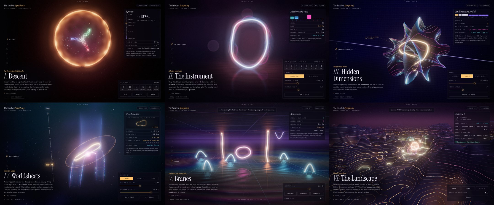

# The Smallest Symphony

A playable journey through string theory in six movements, built with three.js and the Web Audio API.

**Play it: <https://smallestsymphony.com>** (best on a laptop or desktop, with sound on)

You start with a grain of salt and dive down to 10⁻³⁵ m, where string theory proposes that every particle is a tiny vibrating string. Then you play that string yourself. Every movement is interactive, and every interaction makes sound. All of it is in one key (D minor pentatonic), so the whole piece plays as a single composition.



## The six movements

| | Movement | Tempo | What you do |
|---|---|---|---|
| I | **Descent** | Largo, sempre più piccolo | Dive through powers of ten: salt crystal, ionic lattice, electron cloud, nucleus, proton, quark, the "desert" and quantum foam, until a string appears at the Planck length. A Shepard tone falls endlessly as you dive. |
| II | **The Instrument** | Allegro, pizzicato | Pluck a string by dragging it, or add quanta with keys 1–8. What you hear is synthesized from the string's actual vibration modes. A live card shows the state: graviton, photon-like boson, or a massive level with its mass and maximum spin. |
| III | **Hidden Dimensions** | Adagio misterioso | A curled dimension you can hear: momentum and winding tones trade places under T-duality. Then a Calabi–Yau cross-section (Hanson's construction), and a lattice of space with a hidden shape at every point. |
| IV | **Worldsheets** | Scherzo, legato | Slice spacetime and tilt your observer's "now". Two strings join smoothly, with no point where everyone agrees the interaction happened. Point particles meet at a sharp vertex, which is where gravity's loop calculations blow up. |
| V | **Branes** | Andante, sul ponticello | Open strings ride on a membrane while closed loops escape into the bulk. Move a second brane and watch stretched strings gain mass until the gauge symmetry grows from U(1)×U(1) to U(2). |
| VI | **The Landscape** | Finale, maestoso | Drop universes onto a map of ~10⁵⁰⁰ possible vacua. Each one rolls into a valley with its own laws. Make them tunnel, then play the coda. |

Between movements, the whole scene collapses into one plucked gold string and opens into the next movement.

String theory has no experimental confirmation. Every movement's **Look closer** panel says what is established, what is speculative, and what the picture simplifies.

## Run it

**Quickest:** open `dist/index.html` in a browser. It is a single self-contained file. three.js and the fonts load from public CDNs, so you need an internet connection.

**Develop:** serve the source with live module files:

```bash
python3 tools/serve.py 8765
```

Then open <http://127.0.0.1:8765>. Useful query parameters:

- `?m=3` starts at movement III
- `&skip` skips the intro
- `&demo` runs the movement's signature interaction automatically
- `&fps` shows a frame counter
- `&q=low` uses phone quality

Choose **Begin with sound**. Headphones help.

## Build

```bash
tools/build.sh
```

This bundles `src/` with esbuild (fetched through `npx`) into one inline module and writes two files:

- `dist/index.html`: the standalone page, committed so the piece works straight from the repo.
- `dist/page.html`: the body-only version used to publish it as a Claude artifact. It is gitignored.

Set `SITE_URL` to add an absolute social-preview image to the standalone page, for example `SITE_URL=https://smallestsymphony.com/ tools/build.sh`.

## Deploy

Every push to `main` runs `.github/workflows/pages.yml`. The workflow rebuilds the page from source and publishes it to GitHub Pages, along with `docs/og.jpg` as the link-preview image.

## Project layout

```
page.html            HUD, intro and all CSS (the programme around the stage)
src/main.js          boot, intro, test hooks
src/engine.js        renderer, bloom + film post-processing, transitions, input routing
src/audio.js         additive synth, reverb hall, drone, everything in one key
src/ui.js            caption, readout, controls, hints
src/fx.js            palette, star fields, GLSL noise
src/movements/       one self-contained module per movement
SPEC.md              the contract every movement follows, plus the design and copy rules
briefs/              the creative brief each movement was built from
tools/               dev server, build script, headless screenshot harness
```

`tools/snap.sh "m=2&skip&demo" out.png 1440 900 7000` renders a real-time headless screenshot and prints console errors. It expects Google Chrome at the default macOS location. Widths under 760 px emulate a phone.

## Credits

Built with [three.js](https://threejs.org) r170, with Instrument Serif, Hanken Grotesk and IBM Plex Mono from Google Fonts. Simplex noise is by Ashima Arts and Stefan Gustavson (MIT).
